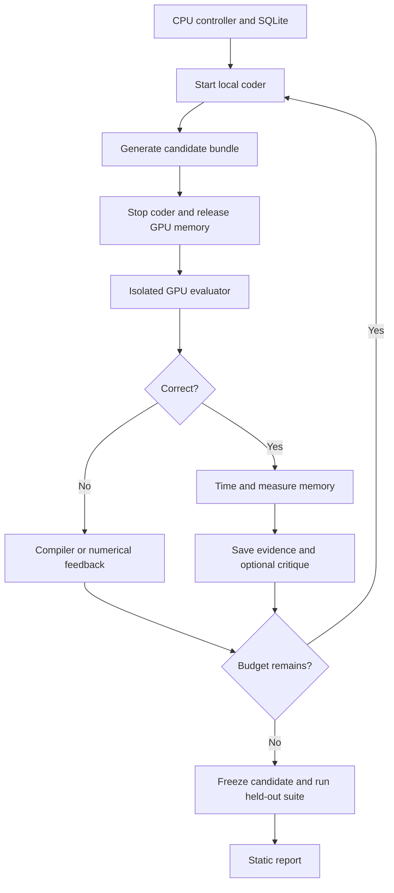

# KernelForge: RTX 5060 Ti implementation plan and coding-agent brief

**Target machine:** NVIDIA RTX 5060 Ti, **8 GB VRAM**, **16 GB system RAM**. Run on native Linux or Ubuntu under WSL2 if the PC uses Windows. No Mac is required, and cloud compute is not a dependency of the core project.

This file is both a detailed implementation plan and a copy-ready brief for Claude Code. The sections inside “Prompt begins” and “Prompt ends” can be supplied directly to a coding agent. The original screenshot contains claimed outcomes rather than source code; this plan independently implements the same categories of work.

**Hardware adaptation:** Use a locally hosted **Qwen2.5-Coder-3B-Instruct Q4_K_M** model first. Its official GGUF file is about **2.1 GB**, before KV cache and runtime overhead. The original **Qwen3-Coder-30B-A3B** checkpoint is an optional remote upgrade: ordinary useful-precision serving does not fit this 8 GB VRAM / 16 GB RAM machine. A 7B Q4 coder is an optional local quality experiment after a memory probe, not the starting requirement.

**Project outcome:** A working loop that generates a Triton kernel, checks it against an independent implementation, measures speed and memory on your GPU, returns feedback to the model, preserves the best valid version, and produces a reproducible report. Small local models can produce weak kernels; correct execution and honest measurement are deliverables even if an agent does not beat the manual kernel.

**Build order:** Environment and references → manual kernels → trustworthy measurements → local agent → critic comparison → report/CI → optional small-model RL.

**Targets:** 22% faster LayerNorm, 60% lower operator memory for MRoPE, and 2.2× generated-kernel speedup remain experiment targets until measured. Use the actual model name and results on a submitted resume.

## Prompt begins

You are an experienced GPU performance engineer and Python systems engineer. Implement **KernelForge**, a compact, reproducible AI-assisted Triton kernel optimization project. Build working code, tests, command-line workflows, and documentation. Do not stop after proposing an architecture.

### 1. Goal and starting environment

I will run this project on a PC with an **NVIDIA RTX 5060 Ti with 8 GB VRAM and 16 GB system RAM**. Detect whether it has native Linux or Windows. On Windows, use **WSL2 with Ubuntu** for standard upstream Triton; do not make a third-party native-Windows Triton fork the default.

The RTX 5060 Ti is Blackwell with compute capability 12.0 (`sm_120`). Use a driver, PyTorch CUDA wheel, Triton version, and optional CUDA toolkit that actually support this architecture. Blackwell support starts with CUDA 12.8; use a currently compatible release and verify real execution. A successful import or `torch.cuda.is_available()` alone is insufficient.

Run orchestration, the generator, and the evaluator on this PC in separate phases. No remote GPU or cloud account is required for the core implementation.

Build these capabilities:

1. An optimized LayerNorm forward kernel in Triton.
2. A fused multimodal rotary-position embedding, or MRoPE, implementation in Triton.
3. A self-hosted, quantized Qwen2.5-Coder-3B agent that proposes kernels, receives execution feedback, and iteratively improves them; make the endpoint interchangeable with an optional remote Qwen3-Coder server.
4. A controlled comparison of Gemini, OpenAI, and Claude models as code critics.
5. Automated correctness tests and benchmarks, with a static GitHub Pages report.
6. A separate, resource-gated implementation of genuine reinforcement learning for kernel generation, with actual parameter updates and evaluation. Finish the core execution-feedback agent first.

The screenshot mentions **22% faster LayerNorm, 60% lower MRoPE memory usage, and 2.2× faster generated kernels**. Store those only in a clearly labeled `targets` configuration. Never fabricate, prepopulate, or present them as achieved results. They are independent targets, not guaranteed outcomes.

Define the targets precisely: 22% faster means a 1.22× latency speedup, which is approximately an 18.0% latency reduction. A 22% latency reduction is a different number. The 60% target refers to a declared operator memory metric, not the memory of an entire language model. The 2.2× target is a kernel/operator result, not full-model throughput.

### 2. Constraints and implementation approach

- Keep the project understandable for one engineer. Prefer a Python CLI, SQLite, JSON artifacts, and a static HTML report. No Kubernetes, message broker, microservice fleet, vector database, web authentication, or frontend build system.
- Use a small number of cohesive modules. Roughly 12–16 production Python files is a guide, not a reason to compress unrelated logic into unreadable files.
- Target Python 3.11 initially. Verify current compatible package releases and lock the versions actually tested.
- Use PyTorch for reference operations, Triton only on the CUDA worker, Pydantic for contracts, Typer or argparse for the CLI, and pytest for meaningful verification.
- Use an OpenAI-compatible interface for self-hosted generation. Keep official OpenAI, Anthropic, and Google critic adapters small and optional.
- Keep the controller, GPU evaluator, model-serving environment, and RL-training environment separate where dependency requirements conflict. Do not force vLLM, TRL, and the evaluator's Triton into one incompatible environment.
- CPU-only installation and imports must work without a GPU. Import CUDA/Triton modules lazily. The actual target run is Linux/WSL2 CUDA on the 5060 Ti. A skipped GPU test must be reported as skipped, never passed.
- Do not provision paid compute, enable billing, publish a repository, or deploy Pages automatically. Implement the workflows and document the required configuration. Use a remote machine only when a host is supplied.
- If a resource is missing, implement all independent work, report the exact unexecuted steps, and give the exact next command. Do not substitute synthetic success data.

### 3. Architecture

Use these boundaries:

**Local controller:** CLI, configuration, workload definitions, experiment state in SQLite, generator/critic clients, managed process/container dispatch, artifact collection, and report generation. It should not initialize a CUDA context itself.

**Local model process:** llama.cpp serving the official Qwen2.5-Coder-3B-Instruct GGUF Q4_K_M checkpoint over a loopback OpenAI-compatible endpoint. Start with a 4096-token total context and one request/slot. The model process runs during candidate generation and is stopped before final GPU evaluation. A remote Qwen3-Coder endpoint is optional and must be identified as a different model configuration.

**Linux GPU worker:** A trusted evaluator and isolated candidate execution environments. It owns tensor generation, correctness decisions, CUDA timing, memory measurements, and environment metadata. The agent cannot edit its tests or benchmark harness.

**Critic providers:** Optional hosted model APIs. They return structured code critiques. They neither execute code nor decide whether a result is correct.

**Artifacts/report:** Immutable candidate source, source hashes, workload manifests, evaluation JSON, raw samples, readable logs, and a generated static HTML dashboard.

Use local process/container execution first. Pass a validated task bundle to a fixed worker entry point and collect a schema-validated result bundle. Avoid any public worker API, SSH dependency, or extra service for the local path. An optional later SSH adapter must verify host identity and must not assemble shell commands from model output.

Use this resource lifecycle:



The extra model reload time is an acceptable tradeoff on this machine. Keep generator processes outside evaluator containers; the controller owns their lifecycle. The evaluator must never need API keys.

Maintain one GPU benchmark job at a time. The controller can resume an interrupted experiment from SQLite. A failed candidate must not destroy earlier successful results.

### 4. Suggested repository layout

Use this organization or a comparably small one:

```text
pyproject.toml
README.md
.env.example
config.example.yaml
Dockerfile.worker
kernelforge/
  __init__.py
  __main__.py          # CLI
  config.py           # configuration and hardware preflight
  contracts.py        # workloads, candidates, results
  references.py       # independent PyTorch implementations
  workloads.py        # development and held-out manifests
  kernels/
    layernorm.py
    mrope.py
  providers.py        # generator and critic clients
  agent.py            # bounded search and feedback loop
  executor.py         # SSH and isolated worker dispatch
  evaluate.py         # trusted correctness and execution
  benchmark.py        # trusted timing/memory measurement
  store.py            # SQLite and artifact persistence
  report.py           # static HTML and evidence export
  train_rl.py         # genuine RL extension
tests/
  test_references.py
  test_agent.py
  test_contracts.py
  test_cuda_kernels.py
.github/workflows/
  checks.yml
  gpu-benchmarks.yml
  pages.yml
```

Generated artifacts belong under an ignored `runs/` directory. Do not commit checkpoints, secrets, or large tensor dumps. Embed a small sanitized example result only if it is unmistakably labeled as a schema fixture and excluded from measured summaries.

### 5. Hardware preflight and operating modes

Implement `python -m kernelforge doctor`.

Report native Linux versus WSL2, distribution, architecture, Python, visible system RAM, swap activity, available disk space, PyTorch version, GPU model, UUID where available, total/free VRAM, driver, CUDA runtime, compute capability, and Triton version. Under WSL report that visible Linux RAM can be lower than the physical 16 GB. Report generator model metadata separately. Do not print API keys.

Provide three explicit modes:

1. `reference`: CPU mathematical verification without Triton.
2. `cuda`: the default local execution path on Linux/WSL2 using the RTX 5060 Ti.
3. `remote`: an optional future adapter, not a prerequisite for any core local feature.

An offline fixture mode can exercise provider parsing and orchestration, but it must never emit measured GPU results.

Preflight the evaluator separately from the generator. A 30B mixture-of-experts model still stores all its weights; its active-parameter count does not make its memory footprint equivalent to a 3B dense model. Do not download or attempt to load the 30B checkpoint by default.

Use these **planning limits, not measured claims**:

| Resource | Initial policy |
| --- | --- |
| Local generator | 3B GGUF Q4_K_M; about 2.1 GB for the weight file, plus measured cache/runtime memory |
| Generator context | 4096 total tokens; reserve prompt space and cap output at 1536 tokens initially |
| Generator concurrency | One request; no parallel slots |
| Benchmark tensor working set | At most 1 GB initially; check estimated live buffers before allocation |
| GPU evaluation concurrency | One job and one workload case at a time |
| Compilation | Limit simultaneous compilation/build jobs to 2 |
| Host memory | Avoid retaining tensor dumps or multiple model copies; detect active swapping |
| WSL memory, if applicable | Start around 10 GB for Linux, leaving about 6 GB for Windows; adjust only after observation |
| Larger local model | Optional 7B Q4 only after a measured load/context test; fall back explicitly if it does not fit |
| Genuine RL | Optional small-model experiment; do not make 30B training a local requirement |

Do not confuse the on-disk quantized file size with the full runtime VRAM requirement. GPU memory used by the display/Windows desktop is unavailable to the project. Measure the free amount each phase. Do not use CPU model offload or system swap to claim the 30B generator is practical here.

Support a configuration such as:

```yaml
mode: cuda
worker:
  transport: local_container
  gpu_index: 0
  concurrent_jobs: 1
  max_tensor_bytes: 1073741824
generator:
  backend: openai_compatible
  runtime: llama_cpp
  base_url: http://127.0.0.1:8000/v1
  model: local-coder
  source_model: Qwen/Qwen2.5-Coder-3B-Instruct-GGUF
  quantization: Q4_K_M
  context_tokens: 4096
  max_output_tokens: 1536
  max_concurrent_requests: 1
  managed_process: true
  stop_before_gpu_evaluation: true
  temperature: 0.7
critics:
  openai_model: null
  anthropic_model: null
  google_model: null
search:
  candidates_per_round: 2
  max_rounds: 4
  max_compile_seconds: 120
  max_execution_seconds: 30
benchmark:
  warmup_iterations: 25
  samples: 50
  calls_per_sample: 20
  independent_sessions: 3
targets:
  layernorm_speedup: 1.22
  mrope_memory_reduction_fraction: 0.60
  generated_kernel_speedup: 2.20
```

`base_url` points to the local managed llama.cpp server. Keep it bound to loopback. Record the actual underlying checkpoint as well as the `local-coder` serving alias. Read hosted-critic secrets from environment variables only. Missing credentials disable only the corresponding critic experiment, not the local project.

The 5060 Ti is shared between generation and evaluation. Track only this project's model-server PID/container. After generation, request a graceful shutdown, wait with a bounded timeout, and confirm process exit plus recovered free GPU memory. Then launch evaluation. Never stop unrelated processes or clear another program's memory. Do not run GPU generation/training computation concurrently with kernel timing. Final headline benchmark and memory results require the generator/training processes to be unloaded. Because WSL may not expose complete process telemetry, combine managed-process status with an allocation/preflight probe rather than relying exclusively on `nvidia-smi` process lists.

### 6. Mathematical contracts: LayerNorm

Implement forward inference only initially. State that backward/gradient support is outside the core scope.

Input `x` has shape `[M, N]`; gamma and beta have shape `[N]`. Normalize across the last dimension:

```text
mean = sum(x) / N
variance = sum((x - mean)^2) / N
y = (x - mean) / sqrt(variance + eps) * gamma + beta
```

Use population variance, FP32 intermediate accumulation, configurable positive epsilon, and an output with the declared input dtype. Start with contiguous FP32 and FP16, then BF16 when the GPU supports it. Validate dtype, device, shape, and layout explicitly. Either implement a layout or reject it clearly; do not silently make an input copy outside the measured path.

References/baselines:

- An independent mathematical reference suitable for CPU tests.
- `torch.nn.functional.layer_norm` as the primary practical CUDA baseline.
- A basic, untuned Triton implementation as a separately labeled baseline.
- Optionally `torch.compile` as an additional optimized comparison, with compilation excluded and its exact setup recorded.

Start with one program per row, masked loads/stores, a power-of-two block, FP32 reductions, fused affine transformation, and explicit launch parameters. Then investigate rows per program, block size, and warp count. Bound autotuning time and do not tune on final held-out workloads.

Development cases should cover M in `{1, 32, 256, 2048}` and N in `{128, 768, 1024, 3072, 4096, 8192}`, with a small smoke subset and a fuller manifest. Include non-power-of-two sizes and separate held-out sizes, such as N=1536 and N=5120. Keep shapes within the detected memory budget.

### 7. Mathematical contracts: multimodal RoPE

Implement a clearly documented **Qwen2-VL-style temporal/height/width rotation operator**. Do not call ordinary one-dimensional RoPE multimodal. This operator does not require loading an entire vision-language model or a real video dataset.

Core inputs:

- `q`: `[B, Hq, S, D]`.
- `k`: `[B, Hkv, S, D]`; support Hq different from Hkv.
- Integer `position_ids`: `[3, B, S]`, containing temporal, height, and width positions.
- FP32 `inv_freq`: `[D/2]`.
- `sections = [nt, nh, nw]`, with `nt + nh + nw = D/2`.

Use split-half rotation. For pair index i in `[0, D/2)`, select axis 0 for the first nt pairs, axis 1 for the next nh, and axis 2 for the remaining nw. Let `theta = position_ids[axis, b, s] * inv_freq[i]`. For either a query or key vector:

```text
out[i]       = x[i] * cos(theta) - x[i + D/2] * sin(theta)
out[i + D/2] = x[i] * sin(theta) + x[i + D/2] * cos(theta)
```

For D=128, an example sections list is `[16, 24, 24]`; for D=64, use `[8, 12, 12]`. Verify the chosen convention against a pinned upstream Qwen2-VL implementation and document the source revision. Do not silently mix split-half rotation with interleaved even/odd rotation. Scaled frequencies and partial-rotary variants are later extensions unless implemented and tested explicitly.

Provide two separately labeled benchmark contracts:

1. **Positions-to-output:** Both baseline and fused implementation receive q, k, position_ids, and inv_freq. Include axis selection, angle computation, trig, and rotation for both sides.
2. **Precomputed-trig-to-output:** Both implementations receive the same precomputed trig inputs. Exclude trig construction from both timing scopes.

Do not compare a candidate with cached trig against a baseline that recomputes it. Do not manufacture excessive temporary tensors merely to increase a memory-reduction figure.

Implement a clean vectorized PyTorch baseline, an optional compiled baseline, and a fused Triton kernel. The fused design should avoid unnecessary full-sized intermediate rotations, concatenations, and expanded trig tensors. Handle q and k's different head counts with masks or a documented launch mapping. Use FP32 intermediate math and explicit output casting. Keep inputs unmodified unless a separate in-place contract is implemented for both sides.

Test synthetic text positions where all axes agree, image grids with fixed temporal positions, and video grids with changing temporal positions. Include B in `{1, 2}`, S in `{128, 1024, 4096}`, D in `{64, 128}`, Hq in `{8, 16}`, and smaller Hkv values. Use a manageable declared subset, plus unseen sequence lengths and seeds. Test reasonably large positions to catch trigonometric precision errors.

### 8. Correctness gates

Correctness must be checked before any candidate is eligible for performance ranking.

- Use independent reference logic and deterministic development seeds.
- Validate shape, dtype, device, finite-value behavior on the supported domain, input preservation, and numerical agreement.
- Include constant rows, low-variance inputs, negative values, epsilon changes, masks/tail elements, and uncommon valid shapes.
- Compare against a higher-precision CPU reference where practical. Set and document dtype-specific tolerances before the search; do not loosen them to accept a candidate.
- Record maximum absolute error, relative error with a documented denominator floor, and pass/fail counts. Never reduce correctness to a single handpicked example.
- Have a frozen held-out manifest and fresh test seeds that are not included in the generator prompt. Freeze candidate code and launch policy before final evaluation. Do not feed held-out failures back into development and still call that same set held out.
- Reject hardcoded outputs, input-dependent shortcuts that violate the contract, no-op kernels, incorrect indexing, input mutation, and unsupported cases disguised as success.
- Include a deliberately wrong kernel and a deliberately failing kernel to verify that the evaluator rejects them. These tests protect the measurement system, not just implementation details.

### 9. Candidate execution and isolation

Treat generated source as untrusted executable code.

- The controller must never import or execute generated modules directly.
- Prefer a narrow candidate contract: Triton JIT kernel source, entry-point name, declared specialization parameters, and bounded launch metadata. Trusted host wrappers own allocation, input creation, argument binding, and result collection.
- Use an AST allowlist as an initial filter. Reject arbitrary host functions, dynamic execution, environment access, shell/network/file access, and unauthorized imports. Static checks are not a complete security boundary.
- Compile and run candidates inside disposable Linux containers on a dedicated worker, with no network, no secrets, a non-root user, read-only reference/evaluator mounts, bounded writable temporary space, dropped capabilities, process limits, and wall-clock timeouts. Expose only the required GPU. Keep the host runner credentials outside the container.
- The trusted evaluator owns final correctness and timing fields. Do not accept a candidate's self-reported latency, errors, or claimed pass status.
- Use safe artifact formats such as JSON and safetensors when tensor export is needed. Do not load arbitrary pickle data from a candidate.
- Persist compile errors, timeouts, validation failures, and source hashes. Quarantine an unhealthy worker after a CUDA fault rather than declaring subsequent failures valid performance samples.

Document the isolation limits of sharing a GPU driver. This is a dedicated development evaluator, not a hardened public arbitrary-code execution service.

### 10. Benchmark methodology

Implement a trusted, repeatable benchmark harness rather than timing a single Python call.

**Timing:** Warm up execution; exclude compilation, autotuning, model generation, SSH, and artifact transfer. Use CUDA events with proper stream synchronization. Collect a distribution of per-call times from repeated batches; start with the configured 50 samples and 20 calls per sample. Increase the batch length when timings approach timer/launch overhead. Record the actual parameters and raw samples.

Interleave or randomize baseline/candidate measurement order within the same session to reduce drift. Repeat final measurements in three independent sessions. Report medians, p10/p90, and paired uncertainty estimates where practical. Do not publish the single fastest sample as the main result.

Separate kernel-only timing from callable/operator timing, and separate device time from host wall time. Use the same declared allocation, caching, output, and mathematical contract on both sides. Do not give the candidate free preprocessing or work outside the timed region. CUDA-graph timing is optional and must be symmetric and separately labeled.

**Memory:** Measure baseline and candidate in clean, equivalent processes. Establish the same input state, synchronize, clear unrelated live outputs, reset CUDA peak-memory statistics, then execute the operation. Record input bytes, output bytes, peak allocated bytes, incremental peak above the input state, and reserved memory separately. State whether the denominator is total operator working memory or incremental memory. Include the returned output in the applicable operator footprint. Never use total `nvidia-smi` process usage as a substitute for operator memory.

Compute:

```text
speedup = baseline_median_ms / candidate_median_ms
latency_reduction_percent = 100 * (1 - candidate_ms / baseline_ms)
memory_reduction_percent = 100 * (1 - candidate_peak_bytes / baseline_peak_bytes)
```

A “without increasing memory” claim needs a recorded metric, measurement resolution, and matching baseline. Do not infer it merely because the kernel has no explicit scratch buffer.

**Coverage and aggregation:** Declare the workload matrix before the final run. Show all workload results, failures, and regressions. Use a geometric mean of per-workload speedups only for a clearly named, matching hardware/dtype/contract group. If the deployable policy falls back to the baseline on unsupported workloads, include those fallback results in the policy-wide aggregate. Do not silently omit failures from a broad performance claim. A best-case result must be labeled best case and name its shape.

Record GPU identity, software versions, precision, input shapes, sections, epsilon, launch configuration, source hash, source revision, baseline implementation, and run timestamps. Flag concurrent GPU activity, clock/thermal drift, and unstable timing. Do not merge results from different GPUs into one unqualified number.

### 11. Agent workflow

Use a bounded state machine, implemented directly in Python:

```text
queued -> generated -> validated -> compiled -> correctness_checked
       -> benchmarked -> critiqued -> revised -> selected -> heldout_evaluated
```

Invalid and failed states must preserve their artifacts and retry counts. Allow safe resumption after interruption.

Give the generator the operator specification, supported layout/dtypes, trusted callable contract, development workloads, baseline source or description, GPU metadata, and prior development feedback. Require structured output containing kernel source, entry point, bounded launch parameters, and an optimization explanation. Validate it before dispatch.

For each round:

1. Start the managed 3B coder and generate a small candidate population. Keep prompts compact enough for its context budget; reject truncated output instead of executing incomplete source. Stop the server and verify GPU release before evaluating the population.
2. Validate schema and source policy.
3. Compile and run development correctness checks.
4. Benchmark only correct candidates.
5. Return concise compile/error/performance feedback and, optionally, a critic's structured suggestions.
6. Request a revision, deduplicate identical source, and stop at the round, token, timeout, and experiment budgets.
7. Choose a candidate using development data; freeze it; evaluate once on the held-out manifest.

Keep the best valid candidate even if a later revision fails. Record the model ID, model revision where available, quantization, prompts, sampling settings, token usage, duration, and critic identity. Do not reveal secrets in persisted request metadata.

Call the core method **execution-guided search** or **iterative refinement**. Model critique and performance feedback alone do not constitute reinforcement learning.

### 12. Controlled critic comparison

Implement these arms: no critic, self-critique by the configured local Qwen coder, OpenAI critic, Claude critic, and Gemini critic. Use exact configurable model IDs. A family name such as “GPT-4” is not an adequate reproducibility identifier. If a requested legacy model is unavailable, record that status rather than silently changing it.

Use matching starting candidates, workload sets, generator settings, revision counts, and approximately matched token budgets. Repeat across several declared seeds. Send the same feedback fields to every critic. Keep the generator fixed so the experiment measures the effect of the critic rather than changing both roles simultaneously.

Ask critics for structured bottleneck hypotheses, correctness risks, and concrete changes. Benchmark the revised code; do not score a critic by whether its prose sounds convincing.

Report valid-kernel rate, compile/correctness failures, development-to-held-out changes, median/aggregate speedups, regression rate, number of revisions, token usage, elapsed time, and estimated cost only when actual usage and a documented pricing source are available. Missing-provider experiments should appear as not run. Include the no-critic control.

### 13. Genuine reinforcement learning extension

Implement this after the core system. It is a separate, optional GPU-training phase constrained by 8 GB VRAM and 16 GB host RAM. The complete local kernel/agent project must remain usable when RL is not run.

Use a currently supported TRL GRPO trainer with LoRA/PEFT or an equivalent documented training stack in its own environment. Verify its current API before coding. Start with a small model such as Qwen2.5-Coder-0.5B-Instruct for integration, after verifying the checkpoint. Training GGUF files is not the plan; use the trainable upstream model with adapters. Do not train the 3B inference model or 30B Qwen3-Coder by default.

For a resource-probe configuration, start with one prompt per device batch, two generations per prompt, LoRA rank 4 or 8, gradient checkpointing, no vLLM training backend, short operator prompts, and bounded generated code. Start with approximately 768 prompt tokens and 512 completion tokens; validate that complete compact kernels fit this budget before a run. Use a small number of actual update steps first. These are trial settings, not a guarantee of convergence or fit. Reduce task/code complexity rather than silently truncating valid kernels.

If the RL checkpoint differs from the main 3B generator or the optional Qwen3 endpoint, identify it clearly. Never claim Qwen3-Coder was fine-tuned when another model was trained. If all initial completions fail, the reward has no learning signal: diagnose this and optionally add a separately labeled supervised warm-start phase using verified small kernels.

Build training and validation tasks from operator specifications and development shapes. Exclude the final held-out tasks. Let the policy generate candidate kernels, and obtain rewards only from the same trusted local evaluator.

Suggested reward:

```text
compile / timeout / correctness failure: -1
correct candidate: clip(log2(baseline_ms / candidate_ms), -0.5, 2.0)
```

This makes every correct candidate preferable to an invalid one while favoring faster correct code. The trainer and evaluator share one GPU, so perform generation, reward evaluation, and optimizer updates sequentially, with explicit synchronization. No training kernels may run during reward timing.

If the training model remains resident during reward evaluation, benchmark baseline and candidate under the same residency and label these as **in-training reward measurements**. They are not final headline benchmarks or operator-memory claims. If the evaluator cannot fit alongside the paused model, use CPU offload/checkpoint-and-release if it fits host RAM, or mark the local RL run unsupported and preserve its integration code. Do not require an impractical model reload/offload scheme to complete the core project.

After saving an adapter, stop and unload training, generate/freeze final candidates, stop the generator, and run the clean independent held-out benchmark. Only this clean run supports the final performance claims.

Implement actual optimizer updates, checkpoint/adaptor saving, seed tracking, and logs of rewards and update steps. Provide a small smoke configuration and a larger configurable run; detect inadequate memory and explain the unmet requirement rather than pretending training ran. Include KL/reference-policy configuration supported by the pinned trainer. Avoid repeatedly training on an all-identical-reward group without diagnosing the missing signal.

Evaluate the base model and trained adapter on identical held-out prompts with equal generation budgets. Compare correctness rate and speedup distributions; report negative or inconclusive results honestly. A training smoke run proves integration, not a general performance improvement. Keep RL out of generated resume claims until an actual training run and evaluation exist.

### 14. Persistence and results

Use SQLite for experiment status and lightweight relationships, with source/log/result files in `runs/<experiment_id>/`. Suggested tables: experiments, tasks, candidates, evaluations, and critic_trials. Use transactions for state transitions and stable IDs/source hashes for deduplication.

Each measured evaluation should have a versioned JSON record including:

```text
schema_version, experiment_id, workload_id, candidate_hash, operator,
evaluation_split, status, failure_stage, hardware, software_versions,
dtype, shapes, layout, contract, baseline_id, launch_config,
correctness_pass, max_abs_error, max_rel_error,
raw_timing_samples, baseline_median_ms, candidate_median_ms, speedup,
memory_metric, baseline_peak_bytes, candidate_peak_bytes,
memory_reduction_percent, contamination_flags, timestamp
```

Use null values for unmeasured metrics. Never encode an unrun kernel as zero milliseconds or a zero-error success. Link each headline result back to its raw records and source hashes.

### 15. Dashboard and automation

Generate a self-contained static HTML report with embedded sanitized result data. It must open locally without a backend and be publishable to GitHub Pages.

Include operator/baseline/hardware filters, correctness coverage, latency distributions, per-workload speedups, memory metrics with explicit definitions, candidate history, critic comparisons, and links or hashes for reproducibility. Show “No GPU measurements yet” in an empty report. Keep aspirational targets visually separate from measured results.

GitHub Actions:

1. CPU CI runs reference, contract, provider-fixture, and state-machine tests. GPU tests are explicitly skipped on runners without a compatible device.
2. GPU benchmarks run through a manually triggered workflow targeting this PC as a configured Linux/WSL2 self-hosted runner, or a manually executed local command. The runner does not need to remain online when the PC is off. Do not assume an ordinary Ubuntu hosted runner includes a GPU.
3. Run candidate containers without runner secrets. Restrict the GPU workflow to trusted revisions; do not execute arbitrary fork pull-request code on a persistent GPU runner.
4. Upload raw results as artifacts. A separate Pages workflow builds/deploys reports when configured. Do not expose credentials, raw private API traffic, or large checkpoints in the site.

### 16. CLI and user workflow

Implement and document commands equivalent to these, with `--help` that matches the actual implementation:

```bash
python -m kernelforge doctor
python -m kernelforge test-reference --device cpu
python -m kernelforge baseline --operator layernorm --mode cuda --suite smoke
python -m kernelforge baseline --operator mrope --mode cuda --suite smoke
python -m kernelforge optimize --operator layernorm --config config.yaml
python -m kernelforge optimize --operator mrope --config config.yaml
python -m kernelforge compare-critics --config config.yaml
python -m kernelforge evaluate-heldout --experiment EXPERIMENT_ID
python -m kernelforge report --experiment EXPERIMENT_ID
python -m kernelforge export-evidence --experiment EXPERIMENT_ID
python -m kernelforge train-rl --config rl.yaml
```

Provide the native-Linux and Windows/WSL2 setup sequences below, an isolated Python environment, a tested CUDA smoke check, worker container build/run instructions, and a managed local llama.cpp serving sequence. Lock compatible versions only after actual verification. Do not install both an arbitrary standalone Triton version and an incompatible PyTorch-pinned Triton dependency.

#### 16A. Windows / WSL2 route

1. Install/update the NVIDIA Windows driver with RTX 5060 Ti support.
2. In an elevated Windows PowerShell terminal, run `wsl --install -d Ubuntu`, then `wsl --update`; use `wsl --list --verbose` to confirm WSL2. Reboot if requested. If Ubuntu already exists, do not overwrite it.
3. Use the Windows driver projected into WSL. **Do not install a Linux NVIDIA display driver inside WSL.** If a CUDA development toolkit is needed for llama.cpp or a build, select the WSL-compatible toolkit-only installation from NVIDIA, not a package that installs Linux drivers.
4. An optional `%UserProfile%\.wslconfig` starting point for this 16 GB PC is:

```ini
[wsl2]
memory=10GB
swap=4GB
```

Apply such changes only after saving work in all running WSL distributions, because `wsl --shutdown` stops them. These limits are tunable planning values, not requirements imposed by NVIDIA. Swap is a recovery buffer, not a substitute for enough RAM; stop memory-heavy runs when active swapping makes measurements unstable.

5. Keep the repository, Python environment, model cache, and build outputs in the Linux home filesystem, for example `~/projects/kernelforge`, rather than repeatedly compiling from `/mnt/c`.
6. Confirm `nvidia-smi` inside Ubuntu. Then verify PyTorch kernels and Triton execution. A GPU visible on the Windows desktop alone does not prove that WSL has working CUDA.
7. If Docker Desktop is used, enable its WSL integration and NVIDIA GPU access; alternatively use a correctly configured Linux Docker/NVIDIA container runtime. Verify `--gpus` execution with a compatible image before relying on candidate isolation.

#### 16B. Native Linux route

Use a supported Ubuntu/Linux distribution and an NVIDIA Linux driver that supports this GPU. Verify `nvidia-smi`. Use the same Python, Triton, llama.cpp, and evaluator setup as below. Skip the WSL-specific memory and driver instructions. Do not install a Windows driver on Linux.

#### 16C. Python and Blackwell smoke checks

Create a virtual environment using Python 3.11 or another currently supported version. Install the chosen PyTorch wheel from the official CUDA 12.8-or-newer index compatible with this GPU and driver. Use the exact install command from official documentation and lock the successfully tested versions. Do not copy an old CUDA 11.x/12.1 installation recipe.

The following is a verification sketch to implement as a maintained script:

```python
import torch

assert torch.cuda.is_available()
print(torch.__version__, torch.version.cuda)
print(torch.cuda.get_device_name(0))
print(torch.cuda.get_device_capability(0))
print(torch.cuda.get_arch_list())
x = torch.randn(256, 256, device="cuda")
y = x @ x
assert torch.isfinite(y).all().item()
torch.cuda.synchronize()
```

Next compile and execute a tiny Triton vector-add kernel on the real device, compare it to PyTorch, and synchronize to surface asynchronous errors. Check for `sm_120`/Blackwell support in the installed combination and actual execution rather than requiring an exact string in `get_arch_list()` as the sole test. Record both PyTorch and Triton versions. Stop here with a precise setup diagnosis if either real execution test fails.

A PyTorch wheel includes its selected CUDA runtime dependencies; the “CUDA Version” shown by `nvidia-smi` is the driver's supported version, not proof that a matching development toolkit is installed. Install a full toolkit only if building a component needs it, and keep its architecture support consistent.

#### 16D. Local generator setup

Use the official llama.cpp build instructions. Prefer a pinned CUDA-capable binary where appropriate, or build with `GGML_CUDA=ON` using a toolkit supporting `sm_120`. Limit compilation to two jobs on this 16 GB machine. Pin and record the llama.cpp commit/release.

Download the official Qwen2.5-Coder-3B-Instruct-GGUF **Q4_K_M** file, record its filename and SHA-256, and avoid downloading every quantization variant. A representative command structure, whose flags must be verified against the pinned release, is:

```bash
llama-server \
  -m /absolute/path/to/qwen2.5-coder-3b-instruct-q4_k_m.gguf \
  --alias local-coder \
  --host 127.0.0.1 \
  --port 8000 \
  -c 4096 \
  -ngl 99 \
  --parallel 1
```

`-ngl 99` requests GPU offload for all layers in this small model; actual successful offload and memory use must be checked. Send one short completion request to `/v1/chat/completions` using the serving alias. Measure model load, free VRAM, context memory, latency, and host RAM. Keep prompt plus output inside the total context budget. Do not enable automatic indefinite prompt-cache growth or multi-request batching.

Wrap the server in the managed lifecycle already specified. Store prompts/candidates on disk, shut down the generator, and only then run the evaluator. Reuse local weight files between rounds. No vLLM server is required for this 8 GB default setup.

### 17. Implementation sequence

**Phase A — PC environment and foundation:** Verify Linux/WSL2, driver, Blackwell-compatible PyTorch/Triton, and a real tiny Triton kernel. Create the package, CLI, configuration, schemas, CPU references, reference tests, workload splits, SQLite persistence, and an empty report. Run CPU tests. Gate later GPU results on the real smoke test.

**Phase B — Baselines and manual kernels:** Implement the trusted CUDA benchmark harness and straightforward LayerNorm/MRoPE Triton kernels. Add GPU tests. Where a GPU is supplied, verify correctness before optimizing. Record the initial baseline results.

**Phase C — Optimizations:** Tune LayerNorm launch choices and implement MRoPE fusion. Measure each change against its declared baseline. Retain regressions in the experiment record. Freeze a manual candidate and run held-out evaluation.

**Phase D — Local agent:** Load the 3B Q4 coder, validate one completion, then implement generator lifecycle, source validation, isolated execution, structured feedback, bounded refinement, deduplication, resumption, and an end-to-end smoke run. Demonstrate that model memory is released before timing. Add an optional larger/remote endpoint only after the local path works.

**Phase E — Critic study:** Add provider adapters and the no-critic control. Run the experiment matrix only for available providers, keeping prompts/budgets comparable.

**Phase F — Automation and report:** Add workflows, artifact uploads, report generation, and evidence export. Confirm the report can be generated from saved results without a live GPU or model endpoint.

**Phase G — RL:** Implement the real training extension, smoke configuration, checkpoint handling, and base-versus-adapter evaluation. Run only when suitable compute is available.

After each phase, run the checks relevant to what changed and briefly state what works, what was actually executed, and what remains dependent on setup or credentials. The target PC has a GPU: implement and run CUDA validation there when the coding agent has access to it. If implementation is happening somewhere else, explicitly mark all unexecuted GPU steps and provide the command to run on the PC. Never silently switch to CPU and report GPU success.

### 18. Acceptance criteria and deliverables

The core project is ready for review when:

- Installation succeeds on the chosen native-Linux or WSL2 environment. CPU-only imports remain possible.
- PyTorch computation and a real Triton smoke kernel run on the RTX 5060 Ti.
- CPU reference and orchestration tests pass; CUDA test status is explicit.
- The local 3B generator can complete one request inside the measured memory budget and is unloaded before final kernel benchmarking.
- Both kernels compile and pass the declared development and frozen held-out cases on a real compatible GPU, when one is available.
- Deliberately incorrect candidates are rejected before performance ranking.
- Benchmark outputs contain raw timing samples, declared memory definitions, baseline identity, and GPU/software metadata.
- The agent completes a bounded experiment, preserves failures, and resumes after interruption.
- Critic results distinguish completed, unavailable, and unrun providers.
- The report reflects the actual result files, including an honest empty state.
- Every performance statement can be traced to an evidence record; no target is presented as measured.
- RL completion is tracked separately and requires real saved parameter updates plus evaluation.

Deliver source code, a clear README, pinned dependency information, example configuration, meaningful tests, a static report generator, CI/workflow definitions, an experiment/evidence schema, and a short demo script showing baseline → generation → failure/feedback → correct revision → measurement → report.

Finish with a concise table of implemented versus executed capabilities, exact commands run, test results, generated artifacts, hardware used, unresolved dependencies, and the next command needed. Do not describe the project as benchmark-complete if no CUDA run occurred.

### 19. Official references to consult

Verify current APIs and compatibility against primary sources before implementation. Record the versions/revisions actually used. These links were checked while preparing this brief on November 1, 2026:

- Triton compatibility: https://github.com/triton-lang/triton#compatibility
- Triton installation: https://triton-lang.org/main/getting-started/installation.html
- Triton LayerNorm tutorial: https://triton-lang.org/main/getting-started/tutorials/05-layer-norm.html
- NVIDIA GPU compute capabilities: https://developer.nvidia.com/cuda/gpus
- CUDA architecture/toolkit matrix: https://docs.nvidia.com/datacenter/tesla/drivers/cuda-toolkit-driver-and-architecture-matrix.html
- PyTorch Blackwell support: https://pytorch.org/blog/pytorch-2-7/
- Current PyTorch installation selector: https://pytorch.org/get-started/locally/
- NVIDIA CUDA on WSL: https://docs.nvidia.com/cuda/wsl-user-guide/index.html
- Microsoft WSL configuration: https://learn.microsoft.com/en-us/windows/wsl/wsl-config
- Official 3B GGUF model: https://huggingface.co/Qwen/Qwen2.5-Coder-3B-Instruct-GGUF
- Trainable small-code-model reference: https://huggingface.co/Qwen/Qwen2.5-Coder-1.5B-Instruct
- llama.cpp build guide: https://github.com/ggml-org/llama.cpp/blob/master/docs/build.md
- llama.cpp server: https://github.com/ggml-org/llama.cpp/blob/master/tools/server/README.md
- Qwen3-Coder model card: https://huggingface.co/Qwen/Qwen3-Coder-30B-A3B-Instruct
- Qwen2-VL reference implementation: https://github.com/huggingface/transformers/blob/main/src/transformers/models/qwen2_vl/modeling_qwen2_vl.py
- TRL GRPO: https://huggingface.co/docs/trl/grpo_trainer
- GitHub self-hosted runners: https://docs.github.com/en/actions/how-tos/manage-runners/self-hosted-runners/add-runners

Credit adapted tutorial/reference code and preserve its applicable license notices. Explain which parts are independent work: kernel changes, trusted measurement, agent integration, controlled critic evaluation, and reproducibility infrastructure.

Start by inspecting the repository and environment, briefly state the implementation order, and begin Phase A. Carry the project forward through every phase possible with the available resources.

### 20. Practical milestones and troubleshooting

Do not promise a fixed completion time. Complete these milestones in order and retain evidence for each:

| Milestone | Demonstration | Main failure to resolve |
| --- | --- | --- |
| Environment | CUDA matmul and Triton vector-add both pass | Driver, `sm_120`, wheel/toolkit/Triton mismatch |
| Mathematics | Independent LayerNorm and MRoPE reference tests pass | Incorrect variance, rotation convention, or axis mapping |
| Manual kernels | Both operators pass real GPU tests | Masks, strides, precision, or launch geometry |
| Measurement | Repeated baseline/candidate distributions and explicit memory metrics | Warmup, compilation, hidden preprocessing, GPU contention |
| Local model | One structured candidate generation within memory budget | Context too large, output truncation, incomplete GPU offload |
| Agent | One complete generate → evaluate → feedback → revise experiment | Invalid source, identical revisions, failure-state handling |
| Reproducibility | Saved evidence regenerates the report offline | Missing metadata, stale source hashes, ambiguous baselines |
| Critic comparison | At least no-critic versus local self-critic; external arms if configured | Unmatched budgets or missing credentials |
| Optional RL | Saved adapter plus logged real updates and held-out evaluation | Out of memory, all-invalid rewards, or no improvement |

Common issues to handle explicitly:

- **`no kernel image is available` / unsupported `sm_120`:** Check the actual driver, PyTorch wheel's CUDA build, Triton compiler version, and any source-built library. Do not treat reinstalling an unrelated system toolkit as an automatic fix.
- **8 GB GPU out of memory:** Stop this project's generator before evaluation, reduce context/output limits or workload size, eliminate retained tensors, and check desktop usage. Never kill unrelated GPU processes.
- **Host RAM exhaustion:** Run one candidate at a time, limit compile jobs, avoid duplicate model loads and large tensor logs, and inspect WSL's configured memory. Swapping may prevent a crash but is not acceptable for performance claims.
- **Small model generates invalid Triton:** Provide one short verified example, the exact signature, bounded changes, and compiler feedback. Restrict the search to a valid skeleton plus launch/configuration edits first. Record this restricted-search mode rather than presenting it as unconstrained kernel synthesis.
- **No speedup:** Keep the result. A good PyTorch baseline can already be efficient. Compare against the basic Triton baseline separately, investigate bandwidth/launch overhead with evidence, and do not slow the baseline down to force a headline.
- **Less than 60% memory reduction:** Report the actual metric and denominator. Fewer intermediates do not guarantee that total working memory falls by 60%.
- **WSL timing noise:** Close games and other GPU workloads, repeat sessions, record that the GPU also drives the desktop, and use observed distributions. Native Linux is an optional later validation environment, not a promise of a larger result.

An optional final integration experiment can insert a frozen correct operator into a small synthetic transformer block and report end-to-end latency separately. Do not imply that the operator-level speedup automatically transfers to full-model throughput.

## Prompt ends
