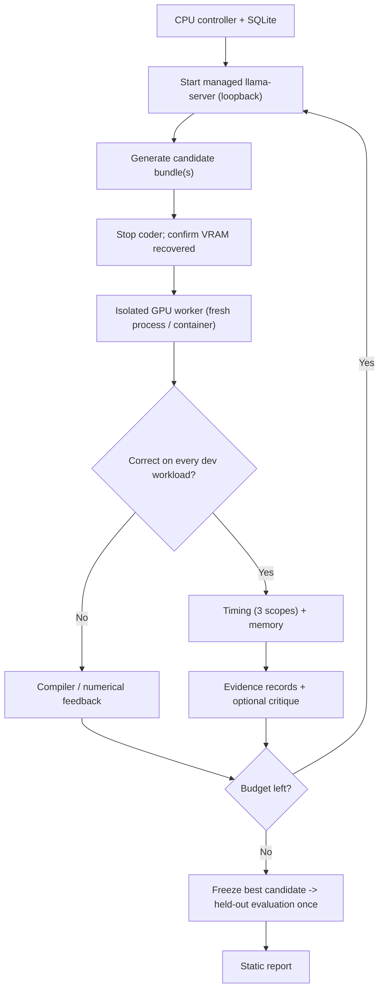

# KernelForge

Execution-guided Triton kernel optimization on a single 8 GB **RTX 5060 Ti** (Blackwell, `sm_120`), with a
trusted evaluator that owns correctness, timing and memory measurement, a locally hosted
**Qwen2.5-Coder-3B-Instruct Q4_K_M** generator, an optional critic comparison, a static report, and an
optional, separately gated RL extension.

> **Results policy.** The three numbers from the original brief — 22% faster LayerNorm, 60% lower MRoPE
> operator memory, 2.2× generated-kernel speedup — live only in the `targets:` block of the config and in a
> separate "Targets" panel of the report. They are never written into evidence records. Every reported number
> links to a JSON evidence record with raw samples, source hashes and hardware/software metadata.
> See [RESULTS.md](RESULTS.md) for what was actually executed on this PC.

## What is in the box

| Capability | Where | Notes |
| --- | --- | --- |
| LayerNorm forward (Triton): untuned baseline + tuned multi-row kernel | `kernelforge/kernels/layernorm.py` | inference only; backward is out of scope |
| Fused Qwen2-VL MRoPE (Triton) | `kernelforge/kernels/mrope.py` | t/h/w sections, split-half, Hq ≠ Hkv, two contracts |
| Independent references + eager / `torch.compile` baselines | `kernelforge/references.py` | float64 CPU references; convention pinned to upstream |
| Trusted evaluator (correctness gates, canaries) | `kernelforge/evaluate.py`, `kernels/canaries.py` | NaN-sentinel outputs, input-preservation, tolerances fixed up front |
| Benchmark harness | `kernelforge/benchmark.py` | CUDA events, randomized interleaving, 3 sessions, paired bootstrap CI, operator / kernel / CUDA-graph scopes, clean-process memory |
| Isolated execution | `kernelforge/executor.py`, `worker.py`, `Dockerfile.worker` | fresh process or disposable container per task; one GPU job at a time |
| Execution-guided search agent | `kernelforge/agent.py`, `providers.py` | managed llama.cpp lifecycle, state machine, resume, dedup |
| Critic comparison | `kernelforge/providers.py`, `agent.compare_critics` | none / self / OpenAI / Claude / Gemini arms |
| SQLite + immutable artifacts | `kernelforge/store.py` | `runs/<experiment_id>/…` |
| Static report + evidence export | `kernelforge/report.py` | self-contained HTML, honest empty state |
| RL extension (GRPO + LoRA) | `kernelforge/train_rl.py` | own environment; rewards only from the evaluator |
| CI | `.github/workflows/` | CPU checks; manual GPU workflow (self-hosted); opt-in Pages |

## Architecture



* The **controller** never creates a CUDA context; GPU facts come from `nvidia-smi` and from worker probes.
* The **worker** (`python -m kernelforge.worker run --task task.json --result result.json`) is the only place
  candidate code is imported. It re-applies the source policy, generates inputs, decides correctness, times,
  measures memory and writes a schema-validated `ResultBundle`. A CUDA fault quarantines the worker; the next
  task starts in a fresh process only after a clean probe.
* The **generator** is any OpenAI-compatible endpoint. By default the controller starts the official
  `llama-server` (llama.cpp `b12024`, CUDA 13.4 build) bound to `127.0.0.1:8000`, with 4096 context, one slot,
  `--cache-ram 0`, and stops it before every evaluation phase, verifying that free VRAM recovered.
* **Critics** only return structured JSON (bottlenecks / correctness risks / changes). They never execute code
  or decide correctness; the evaluator never needs API keys.

## Setup

### Windows / WSL2 (this PC)

1. Install the current NVIDIA Windows driver (RTX 5060 Ti support; this PC: 616.56, driver CUDA 13.4).
2. Elevated PowerShell: `wsl --install -d Ubuntu`, `wsl --update`, `wsl --list --verbose` (must say VERSION 2).
   Do not overwrite an existing distribution.
3. **Do not install a Linux NVIDIA driver inside WSL.** The Windows driver is projected (`/usr/lib/wsl/lib`).
   No CUDA toolkit is needed: PyTorch wheels bundle their runtime, Triton bundles `ptxas`, and llama.cpp ships
   CUDA builds.
4. Optional `%UserProfile%\.wslconfig` starting point (apply only after saving work — `wsl --shutdown` stops every
   distribution):
   ```ini
   [wsl2]
   memory=10GB
   swap=4GB
   ```
   On this PC WSL currently exposes ~7.3 GB; everything here fits in that.
5. Keep the Python environment, model cache and build outputs in the Linux home filesystem. (This repository
   lives on `D:` and is used from `/mnt/d/projects/gpu_infra`; Triton/inductor caches are written under `runs/`.)
6. Inside Ubuntu, confirm `nvidia-smi`, then run the setup script from the repository root:

```bash
bash scripts/setup_wsl.sh
```

It creates `~/venvs/kernelforge` (Python 3.12 via `uv`, `torch==2.10.0` from the official cu128 index,
Triton 3.6.0 as pinned by that wheel), runs the Blackwell smoke check, unpacks llama.cpp `b12024`, downloads
only the Q4_K_M GGUF at a pinned revision, verifies its SHA-256, writes `config.yaml` and runs `doctor`.

7. Docker (optional, for `worker.transport: local_container`): enable Docker Desktop's WSL integration for
   Ubuntu and GPU support, then `docker build -f Dockerfile.worker -t kernelforge-worker:latest .` and verify
   `docker run --rm --gpus all kernelforge-worker:latest python -c "import torch; print(torch.cuda.is_available())"`.

### Native Linux

Use a supported distribution with an NVIDIA Linux driver for this GPU, verify `nvidia-smi`, then run the same
`scripts/setup_wsl.sh` (the WSL-specific notes above do not apply). Do not install a Windows driver.

### Verified versions (see `requirements-gpu.lock`)

| Component | Version |
| --- | --- |
| GPU / driver | RTX 5060 Ti, cc 12.0, 36 SMs, 8 GB; driver 616.56 (CUDA 13.4) |
| OS | Ubuntu 26.04.1 on WSL2 (kernel 6.18) |
| Python | 3.12.16 (evaluator), 3.11+ supported; CI runs 3.11 and 3.12 |
| PyTorch / Triton | 2.10.0+cu128 / 3.6.0 (real matmul + Triton kernel executed on `sm_120`) |
| llama.cpp | b12024 (`0.8.0-dev`, commit ddf48f85c), `ubuntu-cuda-13.4-x64` |
| Generator weights | `Qwen/Qwen2.5-Coder-3B-Instruct-GGUF` @ `f74adce6`, `qwen2.5-coder-3b-instruct-q4_k_m.gguf`, sha256 `724fb256…30b7` |
| RL env | trl 1.17.1, peft 0.21.2, transformers 5.22.1 (separate venv `~/venvs/kernelforge-rl`); policy `Qwen/Qwen2.5-Coder-0.5B-Instruct` @ `ea3f2471` |
| Optional in evaluator env | transformers 5.22.1 (only for the upstream Qwen2-VL convention test) |

## Commands

All commands accept `--config` (default `./config.yaml`). `--help` on each is generated from the parser.

```bash
python -m kernelforge doctor                      # host, WSL RAM, swap, disk, GPU, driver, versions, generator files, key presence
python -m kernelforge smoke                       # CUDA matmul + Triton vector add on the device
python -m kernelforge test-reference --device cpu # independent references (no GPU)
python -m kernelforge selftest-evaluator          # every canary kernel must be rejected
python -m kernelforge baseline --operator layernorm --mode cuda --suite smoke
python -m kernelforge baseline --operator mrope --mode cuda --suite smoke --with-compile
python -m kernelforge tune --operator layernorm   # bounded launch sweep on dev shapes; freezes a manual candidate
python -m kernelforge generator-check             # start llama-server, one request, stop, confirm VRAM release
python -m kernelforge optimize --operator layernorm --config config.yaml
python -m kernelforge optimize --operator mrope --config config.yaml
python -m kernelforge compare-critics --config config.yaml --seeds 0,1,2
python -m kernelforge evaluate-heldout --experiment EXPERIMENT_ID
python -m kernelforge report --experiment EXPERIMENT_ID
python -m kernelforge summarize --experiment EXPERIMENT_ID   # Markdown tables computed from evidence records
python -m kernelforge export-evidence --experiment EXPERIMENT_ID
python -m kernelforge train-rl --config rl.yaml   # run with ~/venvs/kernelforge-rl/bin/python
```

`bash scripts/run_all.sh` is the exact sequence executed on this PC for [RESULTS.md](RESULTS.md).
`bash scripts/demo.sh` runs baseline → generation → failure/feedback → corrected revision → measurement → report
with a scripted generator stand-in (labeled `scripted-demo`) and the real GPU evaluator.

## Mathematical contracts

**LayerNorm.** `x[M, N]`, `gamma/beta[N]`, same dtype (float32 / float16 / bfloat16), contiguous row-major;
`mean = Σx/N`, `var = Σ(x−mean)²/N` (population), `y = (x−mean)/sqrt(var+eps)·γ+β`, FP32 accumulation, output
in the input dtype. Non-contiguous inputs are rejected (no hidden copies).

**MRoPE (Qwen2-VL temporal/height/width).** `q[B,Hq,S,D]`, `k[B,Hkv,S,D]`, `position_ids[3,B,S]` int64,
`inv_freq[D/2]` FP32, `sections=[nt,nh,nw]` with `nt+nh+nw = D/2` (`[16,24,24]` for D=128, `[8,12,12]` for D=64).
Pair `i` uses axis 0 for `i<nt`, 1 for `i<nt+nh`, else 2; `theta = fp32(pos[axis,b,s]) * inv_freq[i]` (an FP32
product); split-half rotation. The convention is checked against a transcription of
`transformers@f90e93c4…/modeling_qwen2_vl.py` (`recomposition_frequencies` + `rotate_half`), and interleaved
rotation is shown to differ. Two benchmark contracts: **positions→output** (both sides get positions and
`inv_freq`) and **precomputed-trig→output** (both sides get the same FP32 `cos/sin[B,S,D/2]`; trig
construction is outside both timing scopes).

**Workloads** (`kernelforge/workloads.py`): `smoke`, `search` (agent benchmark subset), `dev`
(LayerNorm: M∈{1,32,256,2048} × N∈{128,768,1024,3072,4096,8192} × 3 dtypes + non-power-of-two, constant-row,
low-variance, negative, large-offset and epsilon cases; MRoPE: S∈{128,1024,4096} × D∈{64,128} × dtypes, B∈{1,2},
Hq∈{8,16}, Hkv<Hq, text/image/video positions, both contracts, offsets up to 500k), and a frozen `heldout`
manifest with unseen shapes (N=1536/5120/640; S=768/2048/3000/333) and seeds ≥ 9000 that never enter a prompt.

## Correctness gates

* float64 CPU reference on the exact dtype-rounded inputs; elementwise `|out−ref| ≤ atol + rtol·|ref|` with
  tolerances fixed in `contracts.TOLERANCES` before any search (recorded in every record);
  max-abs and max-rel error (denominator floor 1e-3) and mismatch counts.
* Output buffers are pre-filled with NaN (no-op kernels fail), inputs are compared bit-for-bit after the call
  (mutation fails), outputs must not alias inputs, shapes/dtypes/devices are checked, non-finite output fails.
* A candidate must pass **every** dev workload before it is timed; the timing task re-checks each
  implementation on each timed workload.
* Canaries (`selftest-evaluator`): unbiased variance, power-of-two-only tail logic, no-op, hardcoded zeros,
  input mutation, compile error, host code, interleaved MRoPE, single-axis MRoPE.

## Measurement methodology

* **Timing:** warmup excluded (compilation/autotune never timed); batch length doubled until the fastest
  implementation's batch ≥ 0.5 ms; 50 samples × N calls per implementation in randomized interleaved order;
  medians, p10/p90, mean, CV, host wall time; paired per-sample ratios with a 2000-resample bootstrap 95% CI;
  three independent worker sessions for baselines and held-out runs.
* **Scopes (separately labeled):** `operator` — eager calls including output allocation and host dispatch
  (what an eager caller sees); `kernel` — Triton launches into pre-allocated outputs (Triton
  implementations only); `graph` — the same operator calls captured in a CUDA graph and replayed (device time
  without host dispatch, symmetric for every implementation). The agent's selection score uses `graph` (`search.score_scope`): in the pilot an identical kernel timed against itself read 0.93× in `operator` scope but 1.00× in `kernel`/`graph` scope, because small eager calls are host-dispatch bound and noisy under WSL. All three scopes are always recorded and reported.
* **Memory:** one implementation per fresh worker process; same inputs; sync, `empty_cache`, reset peak, one
  call; `incremental_peak_allocated_bytes_including_output` = peak allocated during the call − allocated before
  it (outputs + temporaries; 512-byte resolution). Total-working-set reduction is recorded too. `nvidia-smi`
  process usage is never used as operator memory.
* **Contamination flags:** GPU utilization before timing (other processes / desktop), SM clock drift, thermal,
  `gpu_drives_display`, host swapping, unstable timing (CV > 0.15), generator/trainer resident.
* Aggregates are geometric means per candidate × split × baseline × scope; failures and regressions stay in
  the tables. Results from different GPUs/dtypes/contracts are never merged.

## Agent (execution-guided search, not RL)

States: `queued → generated → validated → compiled → correctness_checked → benchmarked → critiqued → revised →
selected → heldout_evaluated`, with failure states `invalid`, `duplicate`, `compile_failed`, `incorrect`,
`benchmark_failed`, `timed_out`, `worker_error` (the last two are retried at most twice). Every round:
start the coder → generate `candidates_per_round` (prompt kept within 4096 − 1536 tokens; reviewer notes, then
old feedback, are dropped first; truncated output is rejected) → stop the coder and verify VRAM → validate →
correctness on all dev workloads → timing on the `search` subset → feedback (+ critique) → next round. The best
correct candidate is frozen; `evaluate-heldout` runs once (a second run requires `--force` and is flagged).
The round-0 starting candidate for every arm is the untuned Triton kernel. `search.mode: launch_only` is the
recorded restricted-search mode (fixed verified kernel; only launch edits).

## Critic comparison

Arms: `none` (control), `self` (the local Qwen coder), `openai`, `anthropic`, `google` with exact model IDs
from `critics:`. All arms share the generator, seed, starting candidate, workloads, rounds and budgets and receive
an identical payload. A missing SDK or credential marks the arm `unavailable` (recorded, not run). The Claude
adapter deliberately sends no server-side fallback so the arm is served by exactly the configured model; a
`refusal` stop reason is recorded as `refused`. Cost is reported only with actual usage and a documented
pricing source in `critics.pricing`.

## RL extension (optional)

```bash
~/venvs/kernelforge-rl/bin/python -m kernelforge train-rl --config rl.yaml --kf-config config.yaml --smoke
```

GRPO with LoRA on `Qwen/Qwen2.5-Coder-0.5B-Instruct` (pinned revision) in its own environment. Preflight checks
free VRAM/RAM and that prompts (≤ 768 tokens) and a complete reference kernel (≤ 512 tokens) fit. Rewards come
only from the trusted evaluator (−1 for invalid/compile/timeout/incorrect, else
`clip(log2(baseline_ms/candidate_ms), −0.5, 2.0)`), computed after `torch.cuda.synchronize()`; because the policy
stays resident those are labeled **in-training** measurements. A callback stops training with a diagnosis when
every reward group is identical (no learning signal); `warm_start_sft_steps` enables a separately labeled
supervised warm-start. After saving the adapter the trainer is unloaded and base vs adapter are compared on
held-out prompt variants with equal generation budgets. The RL model is never presented as the 3B generator or
as Qwen3-Coder.

On this PC the cold-start smoke run had no learning signal (every completion failed), and with a 24-step warm-start
(`warm_start_sft_steps: 24`) the correctness gain was fully explained by the supervised phase. Attribute any gain by
evaluating the SFT-only adapter on the same prompts:

```bash
~/venvs/kernelforge-rl/bin/python -m kernelforge train-rl --config rl.yaml --kf-config config.yaml --evaluate-only runs/rl/<run>/sft_adapter
```

## Isolation limits

`local_process` gives each task a fresh process, scrubbed environment (no API keys), private HOME/TMPDIR,
rlimits and a wall-clock kill, but shares the network namespace and user permissions; the AST policy (imports,
host code, dunder access, inline asm, prints, comprehensions, unknown names) is a first filter, not a security
boundary. `local_container` adds no network, read-only root, dropped capabilities, non-root user and pids/memory
limits. In both cases candidates share the GPU driver with the host: this is a dedicated development evaluator,
not a hardened service for arbitrary public code. The GPU workflow only runs trusted revisions.

## Remote / larger generators

`worker.transport: remote` is an optional SSH adapter (`StrictHostKeyChecking=yes`, task JSON on stdin; no shell
command is built from model output). A remote Qwen3-Coder-30B-A3B endpoint can replace the local generator via
`generator.runtime: external` and a different `base_url`; it is recorded as a different model configuration. The
30B checkpoint is never downloaded or loaded locally (its MoE weights do not fit 8 GB VRAM / 16 GB RAM at useful
precision).

A local 7B coder fits: `Qwen/Qwen2.5-Coder-7B-Instruct-GGUF` Q4_K_M (4.68 GB) used ~4,681 MiB of VRAM at a
4,096-token context and generated at ~78 tokens/s on the RTX 5060 Ti (the 3B: ~2,211 MiB, ~140 tokens/s). Point
`generator.*` at it (pinned revision and sha256 are in `config.example.yaml`) and run `bash scripts/run_7b.sh`, which
repeats the 3B agent and critic runs with identical settings. Critic-comparison rows are grouped by generator, so
3B and 7B runs are never pooled. Results: RESULTS.md → "7B generator".

## Repository layout

```text
kernelforge/  __main__.py config.py contracts.py references.py workloads.py source_policy.py selfcheck.py
              kernels/{layernorm,mrope,canaries}.py providers.py agent.py executor.py worker.py
              evaluate.py benchmark.py store.py report.py train_rl.py
tests/        test_contracts.py test_references.py test_agent.py test_report.py test_cuda_kernels.py
scripts/      setup_wsl.sh cuda_smoke.py demo.sh
.github/workflows/ checks.yml gpu-benchmarks.yml pages.yml
```

Generated artifacts live under the git-ignored `runs/`. See [NOTICE.md](NOTICE.md) for attribution.
